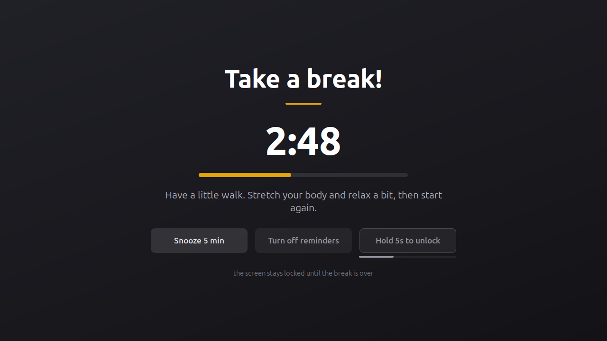
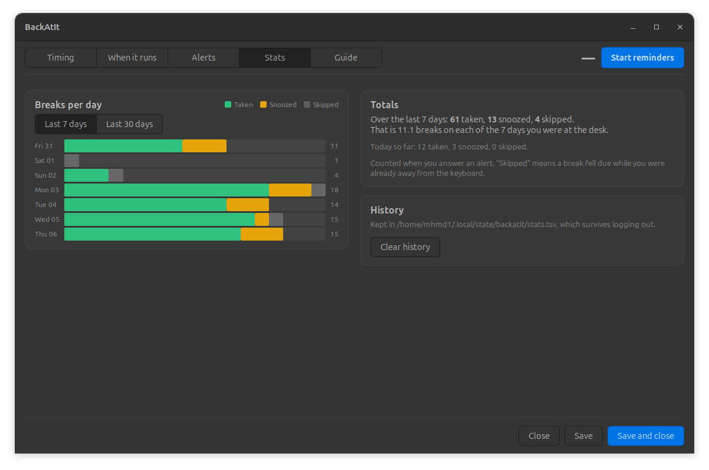

<div align="center">


# BackAtIt

**Get up, walk it off, and actually get back at it.**

A break reminder for Linux that is genuinely hard to ignore — and, unusually,
one that also tells you when the break is over.

[](https://github.com/akashmony01/BackAtIt/releases/latest)
[](https://github.com/akashmony01/BackAtIt/releases)
[](LICENSE)

</div>

---

## Download

Grab the `.deb` from the [**latest release**](https://github.com/akashmony01/BackAtIt/releases/latest),
then:

```sh
sudo apt install ./backatit_1.6_all.deb
```

Or straight from the terminal, without opening a browser:

```sh
wget https://github.com/akashmony01/BackAtIt/releases/latest/download/backatit_1.6_all.deb
sudo apt install ./backatit_1.6_all.deb
```

<sub>That command names a version explicitly; check
[releases](https://github.com/akashmony01/BackAtIt/releases/latest) for the
current filename if a newer one is out.</sub>

Works on Debian, Ubuntu, Mint and anything else `apt`-based. `apt` pulls in
GTK and the other dependencies itself. Remove it later with
`sudo apt remove backatit`.

Not on a `.deb` distro, or would rather build it yourself? See
[Install](#install) below — it is a shell and Python app, so there is nothing
to compile.

---

## Why this exists

This started with back pain.

Sitting through long stretches of work without moving does that, and every
break reminder I tried was far too easy to wave away. A small notification in
the corner, dismissed without even reading it, and another hour gone.

So this one is harder to ignore. When a break is due it takes over the whole
screen and sounds an alarm, and it **ignores the keyboard completely** — so
carrying on typing cannot dismiss it by accident, which is exactly what
happens when an alert lands mid-sentence. You get up because getting up is
easier than arguing with it.

The other half is the part most timers forget: **coming back**. Once your
break is over a second alert calls you back to the desk and keeps nagging — a
burst of alarm, then a longer and longer silence — until you answer it. No
more twenty-minute "five minute" breaks.

Everything about it bends to how you actually work.

---

## Screenshots

| A locked break — the screen is held until it is over | Called back to the desk |
|---|---|
|  |  |

| Timing | Statistics |
|---|---|
|  |  |


---

## What it does

- **Full-screen alerts** that cannot hide behind the window you are working in
- **Keyboard-proof** — nothing you type can dismiss an alert. Buttons that
  cost you something also wait three seconds, so a mouse click already in
  flight when the alert lands cannot dismiss it either
- **Colour-coded** — amber to get up, green to come back, so you know which
  alert it is before you have read it
- **Sized to your screen** — the alerts scale themselves to the monitor they
  land on, so they read the same on a laptop as on a desktop
- **Calls you back** when the break is over, and keeps nagging until you answer
- **Locks the screen for the whole break**, optionally — no button to press,
  no way to carry on working. The break starts the instant the alarm does and
  the mouse and keyboard go with it. Hold the unlock button for five seconds
  if you genuinely need the machine; it ends that break, not your day
- **Knows when you are away** and stays quiet instead of alarming an empty room
- **Daily schedule** with any combination of days off, not just weekends
- **Your words** — the heading and message of both alerts are editable
- **Your sounds** — a different one for each alert, so you can tell them apart
  from another room
- **Statistics** — breaks taken, cut short, snoozed and skipped, over the
  last week or month
- **Fractional minutes** — every timing accepts halves, down to 30 seconds

---

## Install

### From the package (Debian, Ubuntu, Mint)

Either download it from [releases](https://github.com/akashmony01/BackAtIt/releases/latest),
or build it yourself from a clone:

```sh
./build-deb.sh
sudo apt install ./backatit_1.6_all.deb
```

Remove it with `sudo apt remove backatit`.

### From source (any Linux)

```sh
./install.sh                 # just for you       (~/.local)
sudo ./install.sh --system   # for everyone       (/usr/local)
./install.sh --uninstall     # remove it again
```

`install.sh` checks what is missing first and prints the package names for
Debian, Ubuntu, Fedora and Arch.

### Requirements

| Needs | For |
|---|---|
| `bash`, `python3`, `python3-gi` + GTK 3 | the window and the alerts |
| `pw-play` (PipeWire), `paplay` or `aplay` | the sound |
| `notify-send` (libnotify) | the heads-up notifications |
| `gdbus` (glib) | away detection — GNOME only |

On Debian or Ubuntu:

```sh
sudo apt install python3-gi gir1.2-gtk-3.0 libnotify-bin pipewire-bin
```

---

## How a cycle works

1. You work for the break interval.
2. Shortly before it is due, a notification warns you.
3. **"Take a break!"** appears full-screen with the alarm sounding.
4. You click *I took my break!* and walk away.
5. When the break is over, **"Walk time is up"** calls you back and keeps
   buzzing until you click *I'm back at work*.
6. The next work block begins.

The countdown restarts when you **answer**, not when the alert appeared — so
however long an alert sits there, you still get a full work block afterwards.

Step 5 is optional, as is almost everything else.

With **Lock the screen for the whole break** switched on, steps 3 to 5 happen
in one window that never leaves the screen, and step 4 disappears entirely —
there is nothing to acknowledge, because the screen is already locked. The
break starts counting down the moment the alarm sounds, and the window shows
how long is left while holding the mouse and keyboard. You get them back at
step 5. Hold the unlock button for five seconds if you genuinely need the
machine: that ends the break early and is counted as one cut short, but the
next break still arrives on time. Only *Turn off reminders* stops the day.

---

## Where things live

| What | Where |
|---|---|
| Settings | `~/.config/backatit/config` |
| Statistics | `~/.local/state/backatit/stats.tsv` |
| Runtime state | `$XDG_RUNTIME_DIR/backatit/` (cleared at logout) |

Installing, upgrading and removing never touch your settings or statistics.

Upgrading stops the background app, because it reads its code once when it
starts and would otherwise keep serving you the previous version until you
next logged in. Open BackAtIt after an upgrade to start it again.

A few advanced settings are only in the config file:

| Setting | Does | Default |
|---|---|---|
| `BUZZ_ON_MIN` | how long each back-to-work buzz lasts | 1 |
| `BUZZ_GAP_START_MIN` | the first silence between buzzes | 2 |
| `GRACE_SEC` | how long a costly button stays greyed out; `0` turns it off | 3 |
| `LOCK_HOLD_SEC` | how long the unlock button must be held | 5 |
| `LOCK_ALARM_SEC` | how long the alarm sounds on a locked break | 10 |
| `LOCK_RELEASE_MARGIN` | how long past a locked break the input lock gives up on its own | 120 |

Editing that file by hand is safe — the app changes values in place and leaves
your comments alone.

---

## Working on it

| Script | Does |
|---|---|
| `./install.sh` | install or uninstall from source |
| `./build-deb.sh` | build a `.deb` (`VERSION=1.6 ./build-deb.sh`) |
| `./make-icons.sh` | regenerate icon sizes from `logo.png` |
| `./demo-stats.sh on` | fill the stats page with sample data (`off` restores) |
| `./purge.sh --dry-run` | list every trace of the app on the machine |
| `./tests/run.sh` | run the test suite (17 suites, sandboxed) |

Your name, email and version live in `about.conf`, which the About card, the
package metadata and the licence all read from.

### Tests

```sh
./tests/run.sh
```

Seventeen suites covering the schedule and days-off logic, config parsing and
quoting, the daemon's lifecycle, the alert window and its buzzer, the locked
break and its exit codes, and the settings window. They run against sandboxed
copies of the config, statistics and runtime state, so your real settings are
never touched — and the locked-break suites never take the input lock, so a
test run cannot walk off with your mouse and keyboard.

### Layout

```
alarm.sh       launcher — starts the background app, opens the window
alarmd.sh      the background app: timing, scheduling, firing alerts
settings.py    the settings window (GTK 3)
alert.py       the full-screen alert window
alertctl.sh    shows one alert on demand, for the Test buttons
lib.sh         shared shell helpers: config, schedule, sound, stats
```

---

## Portability

Written against the freedesktop desktop standards, so it should run on GNOME,
KDE, XFCE, Cinnamon and the rest. Two things are GNOME-specific and degrade
quietly elsewhere:

- **Away detection** asks GNOME's idle monitor. Off GNOME it reads zero, which
  means "you are here" — so breaks always fire and nothing is skipped.
- **The full-screen alert** prefers XWayland so it can stay on top. Under other
  compositors it still goes full screen.
- **Locking the screen for the break** claims the mouse and keyboard through
  XWayland, which is what stops Super and Alt-Tab getting past it. In a session
  with no X server at all the claim is refused, and the lock quietly falls back
  to what an ordinary alert does — covering the screen and ignoring the
  keyboard. It says so on standard error rather than pretending.

It does **not** run on Windows. The background app is bash, sound goes through
PipeWire, away detection through D-Bus, and start-at-login through
`~/.config/autostart`. Porting means rewriting those four pieces.

---

## Licence

[MIT](LICENSE) — free to use, change and share, including commercially. The
only condition is that the copyright notice stays with it.
