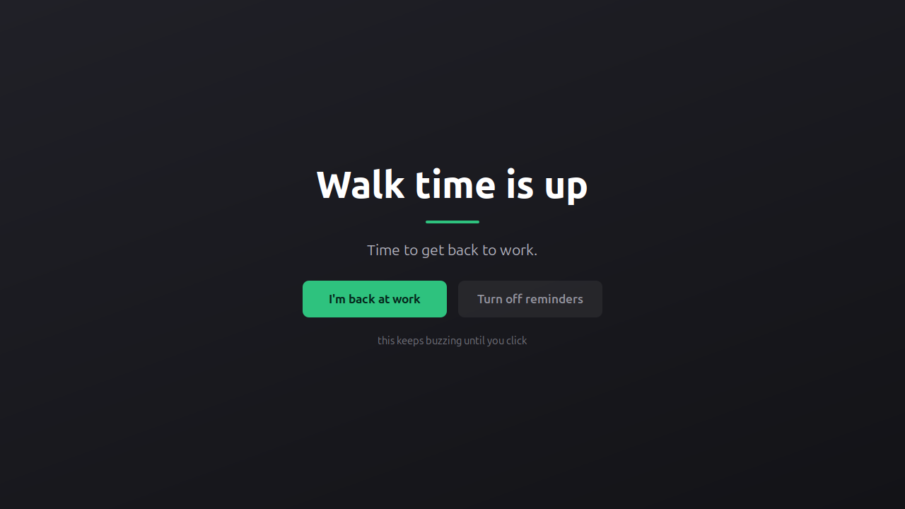
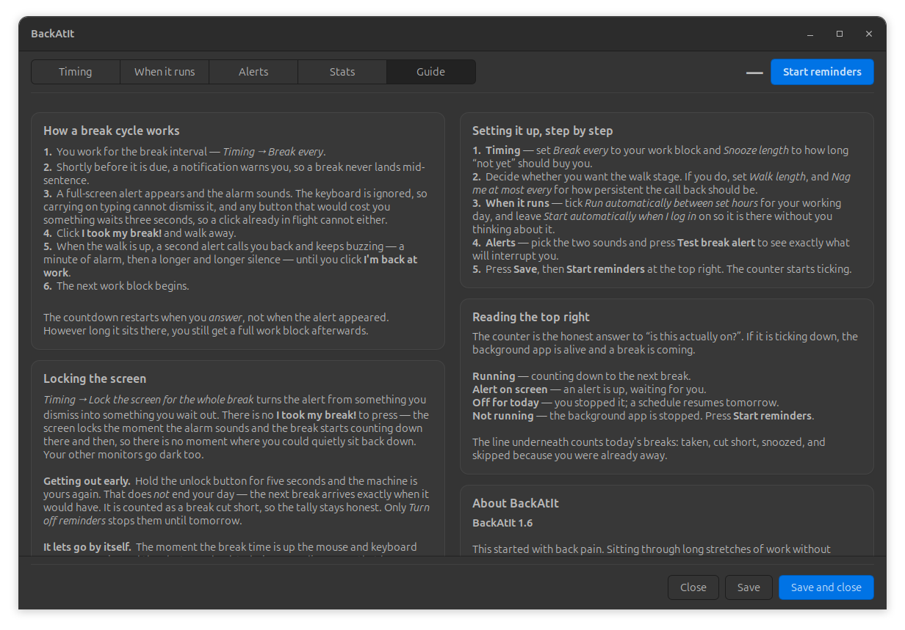

<div align="center">


# BackAtIt

**Get up, walk it off, and actually get back at it.**

A break reminder for Linux that is genuinely hard to ignore — and, unusually,
one that also tells you when the break is over.

[](https://github.com/akashmony01/BackAtIt/releases/latest)
[](https://github.com/akashmony01/BackAtIt/releases)
[](https://github.com/akashmony01/BackAtIt/actions/workflows/tests.yml)
[](LICENSE)

Works on **GNOME · KDE Plasma · XFCE · Cinnamon · MATE · Budgie**

[Download](#download) · [Set up](#set-it-up-on-your-desktop) · [Screenshots](#screenshots) · [Features](#what-it-does) · [Uninstall](#uninstall) · [Help](#if-something-does-not-work) · [Changelog](CHANGELOG.md)

</div>

---

## Download

Pick the file for your distribution from the
[**latest release**](https://github.com/akashmony01/BackAtIt/releases/latest).
It works the same on GNOME, KDE Plasma, XFCE, Cinnamon, MATE and Budgie; the
package only depends on which distribution you run.

**Ubuntu, Debian, Linux Mint, Pop!_OS** (any desktop):

```sh
curl -fLO --progress-bar https://github.com/akashmony01/BackAtIt/releases/latest/download/backatit.deb
sudo apt install ./backatit.deb
```

**Fedora, openSUSE** (any desktop):

```sh
curl -fLO --progress-bar https://github.com/akashmony01/BackAtIt/releases/latest/download/backatit.rpm
sudo dnf install ./backatit.rpm        # openSUSE: sudo zypper install ./backatit.rpm
```

**Anything else** (Arch, Manjaro, …):

```sh
curl -fLO --progress-bar https://github.com/akashmony01/BackAtIt/releases/latest/download/backatit.tar.gz
tar xzf backatit.tar.gz && cd backatit-*/ && ./install.sh
```

<sub>These links always fetch the newest release. `curl -fLO` saves the file in
the folder you are in and replaces an earlier download rather than piling up
copies. If `curl` is missing, `sudo apt install curl` (or `dnf`, `zypper`,
`pacman`) adds it. Once installed, the downloaded file can be deleted.</sub>

The package manager pulls in GTK and the other dependencies itself.
`install.sh` checks what is missing first and prints the exact install command
for your distribution. To update later, run the same commands again.

---

## Set it up on your desktop

**Every desktop, after installing:**

1. Open **BackAtIt** from your applications menu. That also starts the small
   background app that keeps time.
2. Set your break interval and press **Save**. Two things are already on for
   you: **Start automatically when I log in**, so reminders survive a reboot,
   and **Lock the screen for the whole break**, so the alarm screen stays up
   with the mouse and keyboard held until the break is over. Untick either
   one if you would rather not have it.
3. Press **Test break alert** once. It should cover the whole screen and
   sound the alarm, with **Snooze**, **Turn off reminders** and a
   **hold-to-unlock** bar on it. If it does, you are done.

Nothing else is required on any supported desktop. The notes below are only
the places where a desktop's own settings can get in the way.

<details>
<summary><b>GNOME</b> — Ubuntu, Fedora Workstation, Debian, Pop!_OS</summary>

- Nothing to change. This is the desktop BackAtIt was first built on.
- **Do Not Disturb** (in the clock / notification menu) hides the "Break
  coming up" heads-up. The break alert itself still appears.
- Ubuntu 22.04 and older: its `notify-send` cannot report which notification
  it showed, so BackAtIt cannot remove it afterwards. GNOME still drops it from
  the list on its own; a new one may stack under the last instead of
  replacing it.
</details>

<details>
<summary><b>KDE Plasma</b> — Fedora KDE, Kubuntu, KDE neon, openSUSE, Manjaro KDE</summary>

- Nothing to change on Plasma 6, on Wayland or X11.
- **Do Not Disturb** (the bell icon in the system tray) hides the heads-up
  notification. The break alert itself still appears.
- **Start automatically when I log in** shows up in *System Settings → Autostart* as
  "BackAtIt (background)". Removing it there is the same as switching it off
  in the app.
- **Plasma 5** (older Kubuntu, Debian 12) has not been tested. If its
  compositor lacks the Wayland idle protocol, "skip the break if I'm away"
  falls back to noticing you are away only once Plasma itself dims the
  screen. The log says which source it uses (see below).
</details>

<details>
<summary><b>XFCE, MATE, Cinnamon, Budgie</b> — Xubuntu, Linux Mint, Ubuntu MATE, Ubuntu Budgie</summary>

- Nothing to change. These run on X11, where the alert, the lock and away
  detection all use standard X11 features.
- "Skip the break if I'm away" needs the small **libXss** library. The
  packages pull it in automatically; with `install.sh` add it yourself if
  breaks never get skipped: `libxss1` (Debian, Ubuntu, Mint),
  `libXScrnSaver` (Fedora), `libXss1` (openSUSE), `libxss` (Arch).
- A notification daemon must be running for the heads-up to show
  (`xfce4-notifyd`, `mate-notification-daemon` — installed by default).
</details>

<details>
<summary><b>Sway, Hyprland and other tiling setups</b> — best effort</summary>

- Needs **XWayland** for the alert to stay on top and for the locked break to
  hold the keyboard. Without it the alert still covers the screen, but the
  lock cannot be taken.
- Needs a notification daemon such as `mako` or `dunst` for the heads-up.
- Away detection works through the Wayland idle protocol.
</details>

### If something does not work

The background app keeps a log of what it is doing:

```sh
cat "$XDG_RUNTIME_DIR/backatit/daemon.log"
```

| You see | Meaning |
|---|---|
| `away check: 0 sec idle (source: none)` every time | nothing on this desktop reports idle time; breaks always fire. See your desktop's notes above. |
| `away check: … (source: wayland)` / `mutter` / `x11` / `logind` | which source away detection is using |
| `input locked` | the locked break holds the keyboard and mouse |
| `could not lock input (…)` | the lock was refused; the alert still covers the screen. Usually a session with no XWayland. |
| `idle watcher started` | away detection on Wayland is running |

Still stuck? [Open an issue](https://github.com/akashmony01/BackAtIt/issues/new/choose)
— the form asks for your distribution, desktop and those log lines.

---

## Uninstall

| Installed with | Remove it with |
|---|---|
| `.deb` | `sudo apt remove backatit` |
| `.rpm` | `sudo dnf remove backatit` (openSUSE: `sudo zypper remove backatit`) |
| `install.sh` | `./install.sh --uninstall` from the same folder |

That removes the app and keeps your settings and statistics, in case you come
back. To remove **everything** — settings, statistics and the start-at-login
entry as well — run `./purge.sh` from a copy of the source instead
(`./purge.sh --dry-run` lists what it would remove first). It never deletes
the source folder itself.

---

## Why this exists

This started with back pain.

Sitting through long stretches of work without moving does that, and every
break reminder I tried was far too easy to wave away. A small notification in
the corner, dismissed without even reading it, and another hour gone.

So this one is harder to ignore. When a break is due it takes over the whole
screen and sounds an alarm, and it **ignores the keyboard completely** — so
carrying on typing cannot dismiss it by accident, which is exactly what
happens when an alert lands mid-sentence. You get up because getting up is
easier than arguing with it.

The other half is the part most timers forget: **coming back**. Once your
break is over a second alert calls you back to the desk and keeps nagging — a
burst of alarm, then a longer and longer silence — until you answer it. No
more twenty-minute "five minute" breaks.

Everything about it bends to how you actually work.

---

## Screenshots

| A locked break — the screen is held until it is over | Called back to the desk |
|---|---|
|  |  |

| Timing | Statistics |
|---|---|
|  |  |



---

## What it does

- **Full-screen alerts** that cannot hide behind the window you are working in
- **Keyboard-proof** — nothing you type can dismiss an alert. Buttons that
  cost you something also wait three seconds, so a mouse click already in
  flight when the alert lands cannot dismiss it either
- **Colour-coded** — amber to get up, green to come back, so you know which
  alert it is before you have read it
- **Sized to your screen** — the alerts scale themselves to the monitor they
  land on, so they read the same on a laptop as on a desktop
- **Calls you back** when the break is over, and keeps nagging until you answer
- **Locks the screen for the whole break** (on by default) — no button to press,
  no way to carry on working. The break starts the instant the alarm does and
  the mouse and keyboard go with it. Hold the unlock button for five seconds
  if you genuinely need the machine; it ends that break, not your day
- **Knows when you are away** and stays quiet instead of alarming an empty room
- **Daily schedule** with any combination of days off, not just weekends
- **Your words** — the heading and message of both alerts are editable
- **Your sounds** — a different one for each alert, so you can tell them apart
  from another room
- **Statistics** — breaks taken, cut short, snoozed and skipped, over the
  last week or month
- **Fractional minutes** — every timing accepts halves, down to 30 seconds

---

## Install

### From a package

Download one from [releases](https://github.com/akashmony01/BackAtIt/releases/latest)
(see [Download](#download)), or build it yourself from a clone:

```sh
./build-deb.sh     # -> backatit_<version>_all.deb       needs dpkg-dev, fakeroot
./build-rpm.sh     # -> backatit-<version>-1.noarch.rpm  needs rpm-build
```

### From source (any Linux)

```sh
./install.sh                 # just for you       (~/.local)
sudo ./install.sh --system   # for everyone       (/usr/local)
./install.sh --uninstall     # remove it again
```

`install.sh` checks what is missing first and prints the install command for
your distribution (apt, dnf, zypper or pacman).

### Requirements

| Needs | For |
|---|---|
| `bash`, `python3`, `python3-gi` + GTK 3 | the window and the alerts |
| `pw-play` (PipeWire), `paplay` or `aplay` | the sound |
| `notify-send` (libnotify) | the heads-up notifications |
| `gdbus` (glib) | away detection on GNOME |

| Distribution | Command |
|---|---|
| Debian, Ubuntu, Mint | `sudo apt install python3-gi gir1.2-gtk-3.0 libnotify-bin pipewire-bin` |
| Fedora | `sudo dnf install python3-gobject gtk3 libnotify pipewire-utils` |
| openSUSE | `sudo zypper install python3-gobject python3-gobject-Gdk typelib-1_0-Gtk-3_0 libnotify-tools pipewire-tools` |
| Arch, Manjaro | `sudo pacman -S python-gobject gtk3 libnotify pipewire` |

---

## How a cycle works

1. You work for the break interval.
2. Shortly before it is due, a notification warns you.
3. **"Take a break!"** appears full-screen with the alarm sounding.
4. You click *I took my break!* and walk away.
5. When the break is over, **"Walk time is up"** calls you back and keeps
   buzzing until you click *I'm back at work*.
6. The next work block begins.

The countdown restarts when you **answer**, not when the alert appeared — so
however long an alert sits there, you still get a full work block afterwards.

Step 5 is optional, as is almost everything else.

That is the cycle with **Lock the screen for the whole break** switched off.
With it on — the default — steps 3 to 5 happen
in one window that never leaves the screen, and step 4 disappears entirely —
there is nothing to acknowledge, because the screen is already locked. The
break starts counting down the moment the alarm sounds, and the window shows
how long is left while holding the mouse and keyboard. You get them back at
step 5. Hold the unlock button for five seconds if you genuinely need the
machine: that ends the break early and is counted as one cut short, but the
next break still arrives on time. Only *Turn off reminders* stops the day.

---

## Where things live

| What | Where |
|---|---|
| Settings | `~/.config/backatit/config` |
| Statistics | `~/.local/state/backatit/stats.tsv` |
| Runtime state | `$XDG_RUNTIME_DIR/backatit/` (cleared at logout) |

Installing, upgrading and removing never touch your settings or statistics.

Upgrading stops the background app, because it reads its code once when it
starts and would otherwise keep serving you the previous version until you
next logged in. Open BackAtIt after an upgrade to start it again.

A few advanced settings are only in the config file:

| Setting | Does | Default |
|---|---|---|
| `BUZZ_ON_MIN` | how long each back-to-work buzz lasts | 1 |
| `BUZZ_GAP_START_MIN` | the first silence between buzzes | 2 |
| `GRACE_SEC` | how long a costly button stays greyed out; `0` turns it off | 3 |
| `LOCK_HOLD_SEC` | how long the unlock button must be held | 5 |
| `LOCK_ALARM_SEC` | how long the alarm sounds on a locked break | 10 |
| `LOCK_RELEASE_MARGIN` | how long past a locked break the input lock gives up on its own | 120 |

Editing that file by hand is safe — the app changes values in place and leaves
your comments alone.

---

## Working on it

| Script | Does |
|---|---|
| `./install.sh` | install or uninstall from source |
| `./build-deb.sh` | build a `.deb` (version from `about.conf`) |
| `./build-rpm.sh` | build an `.rpm` |
| `./build-tarball.sh` | build the source tarball |
| `./make-icons.sh` | regenerate icon sizes from `logo.png` |
| `./demo-stats.sh on` | fill the stats page with sample data (`off` restores) |
| `./purge.sh --dry-run` | list every trace of the app on the machine |
| `./tests/run.sh` | run the test suite (18 suites, sandboxed) |

Your name, email and version live in `about.conf`, which the About card and
the package metadata read from.

### Tests

```sh
./tests/run.sh
```

Eighteen suites covering the schedule and days-off logic, config parsing and
quoting, the daemon's lifecycle, idle detection on every desktop, the alert window and its buzzer, the locked
break and its exit codes, and the settings window. They run against sandboxed
copies of the config, statistics and runtime state, so your real settings are
never touched — and the locked-break suites never take the input lock, so a
test run cannot walk off with your mouse and keyboard.

### Layout

```
alarm.sh       launcher — starts the background app, opens the window
alarmd.sh      the background app: timing, scheduling, firing alerts
settings.py    the settings window (GTK 3)
alert.py       the full-screen alert window
alertctl.sh    shows one alert on demand, for the Test buttons
lib.sh         shared shell helpers: config, schedule, sound, stats, idle time
idle.py        idle time on Wayland (KDE, Sway, …) and X11 desktops
deps.sh        what to install, per distribution
stage.sh       the package layout shared by build-deb.sh and build-rpm.sh
```

### Releasing

Releases build and publish themselves. Bump `APP_VERSION` in `about.conf`, add
a `## <version>` section to `CHANGELOG.md`, commit, then:

```sh
git tag v2.2          # v + the APP_VERSION in about.conf
git push origin main v2.2
```

The [release workflow](.github/workflows/release.yml) checks the tag matches
`about.conf`, runs the whole test suite, builds the `.deb`, `.rpm` and
tarball, and publishes the release with that changelog section as its notes.
Each file is attached twice: under its versioned name, and as
`backatit.deb` / `backatit.rpm` / `backatit.tar.gz`, which the download
commands above point at.
If any step fails, nothing is published.

---

## Desktop notes

Supported: **GNOME, KDE Plasma, XFCE, Cinnamon, MATE and Budgie**, on Wayland
or X11. Tiling compositors (Sway, Hyprland, …) are best effort. Everything is
written against the freedesktop standards; where a desktop has no standard
answer, it gets its own:

| | GNOME | KDE Plasma 6 | XFCE, MATE, Cinnamon, Budgie (X11) |
|---|---|---|---|
| Full-screen alert on top | ✓ | ✓ | ✓ |
| Locked break holds keyboard and mouse | ✓ | ✓ | ✓ |
| "Skip if I'm away" reads idle time from | Mutter | Wayland idle protocol | X11 screensaver extension |
| Notifications clear themselves | ✓ | ✓ | ✓ |

- **Away detection** tries, in order: GNOME's idle monitor, the Wayland idle
  protocol (a small watcher runs beside the background app), the X11
  screensaver extension, and the login session's idle flag. If none answers it
  reads zero — "you are here" — so breaks fire rather than being skipped.
- **The locked break** claims the mouse and keyboard through XWayland, which
  is what stops Super and Alt-Tab getting past it. In a session with no X
  server at all the claim is refused, and the lock falls back to what an
  ordinary alert does — covering the screen and ignoring the keyboard. It says
  so on standard error rather than pretending.
- **Tested by hand** on GNOME (Ubuntu) and KDE Plasma 6.8 (Fedora 45). The
  X11 desktops rely on the same standards but have not been checked on a real
  machine yet, and blanking extra monitors during a locked break has only been
  tried on GNOME.

It does **not** run on Windows. The background app is bash, sound goes through
PipeWire, away detection through D-Bus, and start-at-login through
`~/.config/autostart`. Porting means rewriting those four pieces.

---

## Contributing

Bug reports and ideas are welcome — [open an issue](https://github.com/akashmony01/BackAtIt/issues/new/choose).
Reports from desktops other than GNOME and KDE are especially useful, since
those have not been tried on real machines yet.

To work on the code, clone it and run `./tests/run.sh` (see
[Working on it](#working-on-it)). Every push and pull request runs the same
suite on GitHub.

---

## Licence

[MIT](LICENSE) — free to use, change and share, including commercially. The
only condition is that the copyright notice stays with it.
